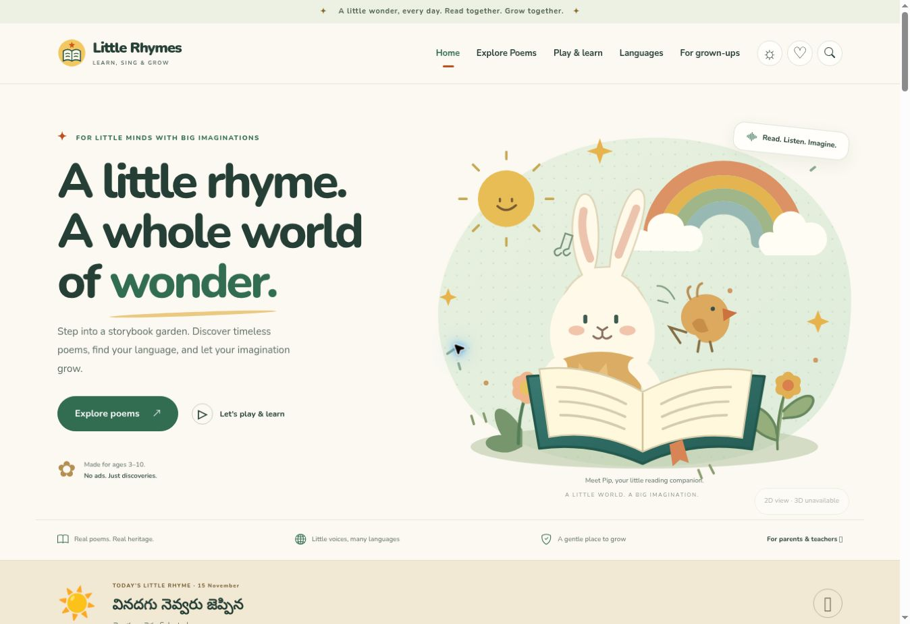

# Verified live release — 15 November 2026

Website: https://little-rhymes-1.onrender.com/
Admin login: https://little-rhymes-1.onrender.com/admin/login/?next=/admin/

Application commit: `35b2077b783e022824ad9e9fd456ca3ed26838b4`.
Render deploy: `dep-dbspf2e417fc73fp8smg`, confirmed `live` at
11:30:43 UTC (17:00:43 IST), 15 November 2026.

## Checks completed

- **96 automated Django tests pass**, locally and in GitHub CI with PostgreSQL 16.
  CI run: https://github.com/VV244/little-rhymes/actions/runs/43709129405
- TypeScript type checking, esbuild compilation, migration consistency and
  production static collection passed. Production Django checks reported no
  errors; optional HSTS subdomain/preload flags remain deliberately unchanged.
- **18 public HTTP checks passed**, including homepage, health, activities,
  parent tools, sources, admin login, English/Marathi readers, Japanese/Sanskrit
  collections, daily rhyme, source status, APIs, sitemap, privacy and contact.
- Public API confirms **33 published poems**, including **17 sourced classics**.
  The combined UK / age 3 / sourced-classic filter returns four matching poems.
- Live English narration loaded, played to completion without a media error,
  and supports HTTP 206 byte-range seeking. Line replay was checked against its
  measured cue; no word timings were invented for recordings.
- All ten learning activities were exercised in browser QA, including completion
  of the memory game. A live rhyming-game answer returned the expected feedback.
- Browser-local favourites and reading lists persisted across page navigation.
- The admin login page is reachable. Existing staff credentials were preserved;
  no password was read, changed or reset, and no live staff sign-in was attempted.
- Live source status shows actual successful Wikisource checks. Imports remain
  editorial candidates, never automatically published poems. Daily scheduling
  is configured; the first unattended scheduled run has not yet been observed.

## Graphics and narration limits

The managed QA browser has WebGL disabled and no installed speech voices.
The illustrated 2D fallback was therefore verified visually. Each of the five
Three.js scene graphs also passed construction and narration-event checks with
an isolated renderer stub; this is **not** GPU rendering or visual verification.
Check the full 3D scene on a WebGL-enabled phone/computer before claiming GPU
visual QA. Reduced-motion, low-memory and Save-Data devices retain the 2D view.

Five English classics have bundled synthetic recordings. Other languages use
an available matching device voice or an administrator-supplied licensed audio
file. Optional Azure Speech integration requires the operator’s own resource,
credentials and provider terms; it is not configured or represented as live.

Operations and editorial guide: [STORYBOOK_UPGRADE.md](STORYBOOK_UPGRADE.md).
